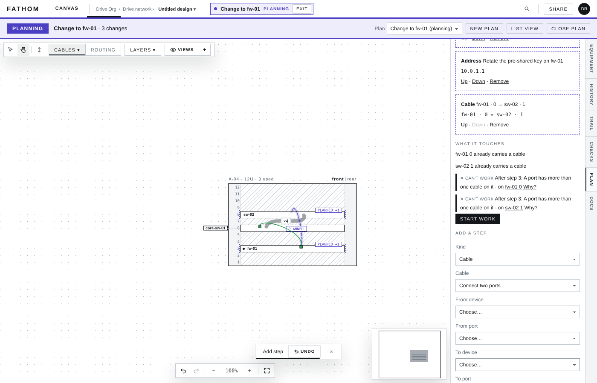
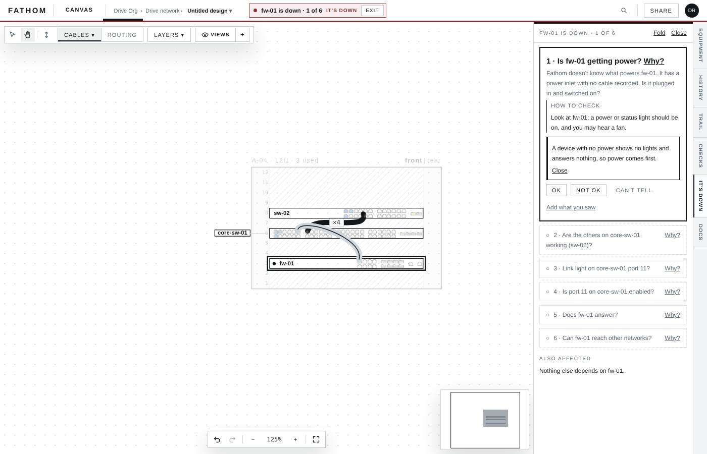
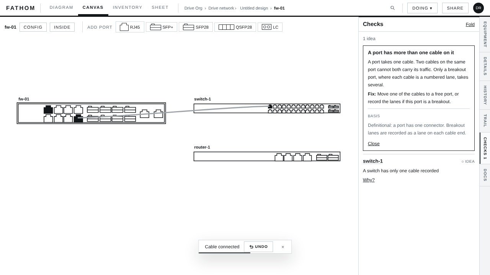
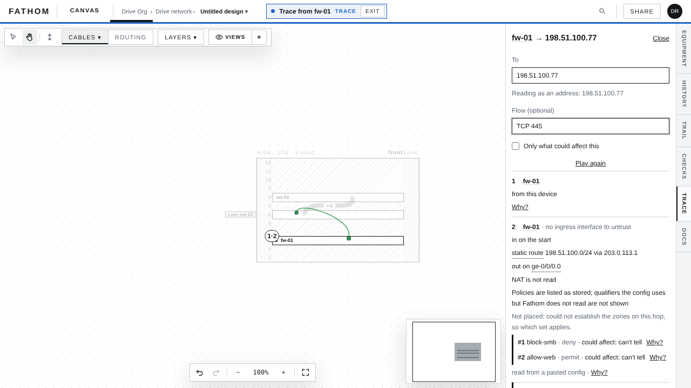
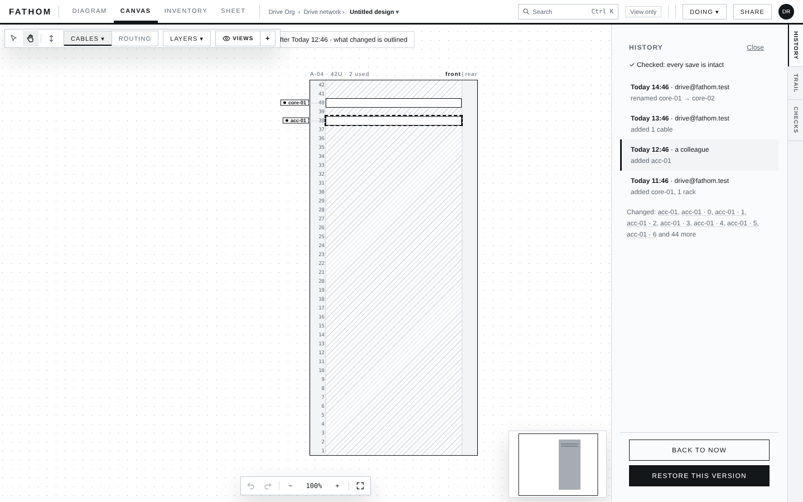

# Fathom

A security-first network documentation and diagramming tool. One typed graph, several views over it:
a drawing (racks, devices, ports, cables), an inventory, checks that say why, plans, and docs.
Teaching and estate-of-record are co-equal goals.

**Server product.** Data lives on the server and the browser is a window onto it. Multi-tenant,
organisations and designs, live co-editing.

**Status:** see the top of `CLAUDE.md`, the one place it is kept. What exists is in `docs/STATE.md`;
what is next is in GitHub issues and the roadmap below.



## What it does

**Plan, do, record.** Right-click a device and plan a change as ordered steps. Fathom draws the plan
on the canvas in its own colour and lists what it touches before anything changes, with the checks
the change would break and why. Start work and it becomes a checklist, one live step at a time;
a step that went differently is recorded as such, and **Back out** writes the plan back to where you
started. The finished record is never edited again.

**Troubleshoot.** "It's down" walks a device through ordered questions (power, neighbours, link
light, port state, does it answer, can it reach other networks), each with how to check it and why
it comes in that order. You answer OK, Not OK or Can't tell and can add what you saw.



**Checks that say why.** The Rust engine runs in the browser and checks the open design against
written rules: addresses on a link, VLAN access and trunk, cable media, link speed, one cable per
port, single-fed power, single-cabled switches. Every finding has a **Why?** card with the plain
reason, the fix, when it is acceptable and where the rule comes from. A wrong drop is refused with a
card naming the rule.



**Trace a path.** Pick a device and an address, optionally a flow such as TCP 445, and Fathom walks
the routes and policies it has read, hop by hop, saying where it could not establish the next step
rather than guessing.



**And the rest.** Paste a config and Fathom reads it (Junos SRX and EX, EdgeOS, OPNsense, pfSense,
MikroTik RouterOS, Linux hosts, TP-Link and UniFi switches), with credentials destroyed in the
browser first. Inventory with spares and stores, firmware tracking with upgrade plans, docs per
device, a history of every save with the chain checked in words, print packs and labels, a phone
field view, lessons and a practice lab, and AI access that reads a design and suggests changes a
person accepts or dismisses.



## Passwords: Fathom stores them when you choose to

Fathom has a **password vault** for device logins (ADR-0042, built in ADR-0071). It is separate from
the design and is never part of a design, an export or an AI reading.

- Logins are sealed in your browser under your passphrase and Emergency Kit, and shared by signed
  holder lists. A recovery sheet is held for every login and its use is logged.
- A login can be marked so Fathom itself can use it, only for that device, with the owner's consent
  and a second admin's countersignature. Every use is written to the organisation's history first.
- Breach checks against Have I Been Pwned run in the holder's browser, by hash range only.
- Outside vaults can be connected instead: Vaultwarden, Delinea Secret Server and Passbolt.

What it will not do is keep a credential nobody chose to keep. The redaction gate (Rust, compiled to
WebAssembly, run in the browser) destroys passwords, pre-shared keys and community strings in a
pasted config before anything is stored or sent, and the server refuses any that still arrive. A
secret typed by hand into a free-text field is not pasted config: Fathom marks it and stores it as
typed (ADR-0041).

The server holds the keys that encrypt designs and says so (ADR-0040). `CLAUDE.md` rule 5 lists the
four sentences that stay forbidden until customer-held keys are real; `scripts/forbidden-claims.sh`
enforces it.

## Roadmap

The full list is [issue #61](https://github.com/keyxmakerx/Fathom/issues/61) and the open issues.
The large pieces ahead:

| | | |
|---|---|---|
| **Termix** | Built, proved against a real Termix | From a device or a plan, "Open in Termix" opens the device's terminal in a new tab; Inventory can send many devices at once and shows which are in Termix. In a plan, steps with commands go to Termix as snippets, Start work can open a maintenance window, and a check step compares what you paste, or, if a steward turns it on, fetches a read-only command through Termix. A Vaultwarden login goes only as a reference, never the password, and Fathom's server never calls Termix. Every part is optional and has a plain way beside it (ADR-0078, ADR-0080). |
| **SNMP** | Planned | Read device state over SNMP (v3 first): what is up, interface status, what is plugged in. Today Fathom never touches a device; reading SNMP changes that rule, so it gets its own decision record before any code ([#58](https://github.com/keyxmakerx/Fathom/issues/58), [#56](https://github.com/keyxmakerx/Fathom/issues/56)). |
| **Discovery** | Planned | Scan a network and approve what it finds before any of it enters a design ([#56](https://github.com/keyxmakerx/Fathom/issues/56)). Same rule change as SNMP. |
| **Plans that branch** | Partly built | A step can carry one If path ("if the port is already in use, do this instead"), and release notes or a change log can be pasted into a plan, with the lines that name what it touches marked. Next: showing on the canvas what each path would change. |
| **Plan, maintain, troubleshoot, check** | Built, by hand | One loop: a plan becomes the night's work, a step that goes differently opens Troubleshoot, and every plan ends with checks after the work before it can be recorded. Next: checks answered by Fathom reading the device, which waits on SNMP. |
| **Import from Docker and Proxmox** | Planned | [#57](https://github.com/keyxmakerx/Fathom/issues/57). |
| **More platforms** | Ongoing | Arista EOS, Cisco, Calix, Nokia and others ([#47](https://github.com/keyxmakerx/Fathom/issues/47)). |
| **Mail and passkeys** | Planned | Password reset and notices by mail; passkey sign-in ([#53](https://github.com/keyxmakerx/Fathom/issues/53)). |

## Try it

```
cp .env.example .env     # set FATHOM_OPERATOR_NOTICE_ADDRESS and FATHOM_SETUP_PASSWORD
docker compose up -d
```

Open the published port behind your own TLS proxy, redeem the setup token, sign in. Full steps, from
source too: `docs/RUNNING-IT.md`. Keys, backups, restore and rekey: `docs/OPERATING.md`. Short worked
tasks on what main supports: `docs/EXAMPLES.md`. To connect Termix, set `FATHOM_TERMIX_URL`.

## Where things are

| | |
|---|---|
| `CLAUDE.md` | Rules that bind every session; the pointer page |
| `docs/STATE.md` | What is built right now |
| `docs/RUNNING-IT.md`, `docs/OPERATING.md` | Running it; keys, backups, restore, rekey |
| `docs/EXAMPLES.md` | Short worked tasks on what main supports |
| `docs/UPGRADING-A-JUNIPER.md`, `docs/UPGRADING-A-CISCO-OR-ARISTA.md` | Firmware upgrades by hand, the steps Fathom's plans carry |
| `docs/UI-SPEC.md` | The interface, approved |
| `docs/PHASE-2-STORAGE-DESIGN.md`, `docs/PHASE-2-ADMIN-AND-AUDIT-DESIGN.md` | Server design of record: encryption, chains, grants, roles (§ numbers are cited from code) |
| `docs/OPEN-QUESTIONS.md` | Closed; answers the code cites by letter (B5, E2, ...) |
| `docs/decisions/` | ADRs; `README.md` is the index |
| `docs/NEXT.md` | How to work on it |
| `docs/REBUILD-PLAN.md` | The rebuild's reasoning and phases |
| `docs/images/readme/` | The pictures on this page, taken from the browser drive scripts |
| `docs/archive/` | History. Do not read unless a task names a file |
| `.context/` | Conventions and the owner's original inputs |
| `schema/` | The declared graph schema (a field not here does not exist) |
| `corpus/` | Device dictionaries, catalogue, rules (with fixtures), explainers; CC BY-SA 4.0 |
| `crates/` | Rust: engine crates (`fathom-schema`, `-ir`, `-graph`, `-ingest`, `-rules`, `-layout`, `-wasm`, ...) and `fathom-server` |
| `client/` | React + Vite + React Flow web app, plain CSS |
| `deploy/`, `compose.yaml` | The image and the composed stack |
| `scripts/` | CI gates and the browser drive scripts |

## Contributing

`CONTRIBUTING.md`. Sign off commits (DCO). Before a pull request, run the checks in
`CONTRIBUTING.md` §4.

Licence: Apache-2.0 (`LICENSE`, `NOTICE`); `corpus/` is CC BY-SA 4.0. *Fathom* is a working name
(ADR-0005 requires a rename before publication).
